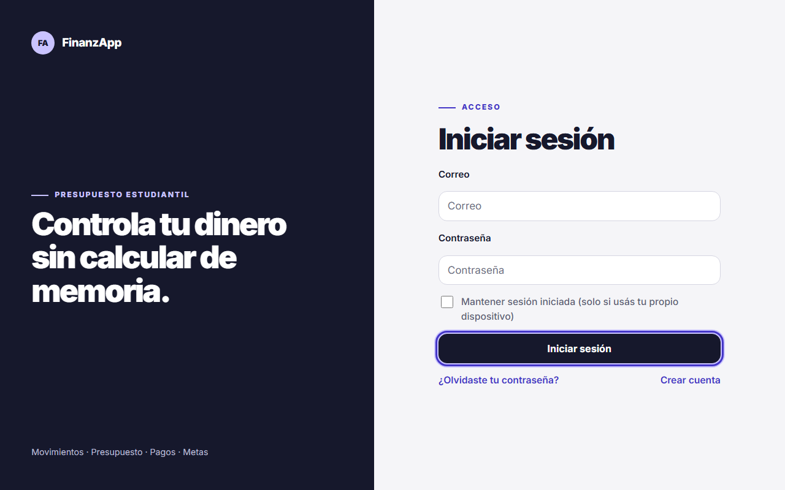
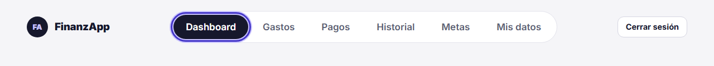
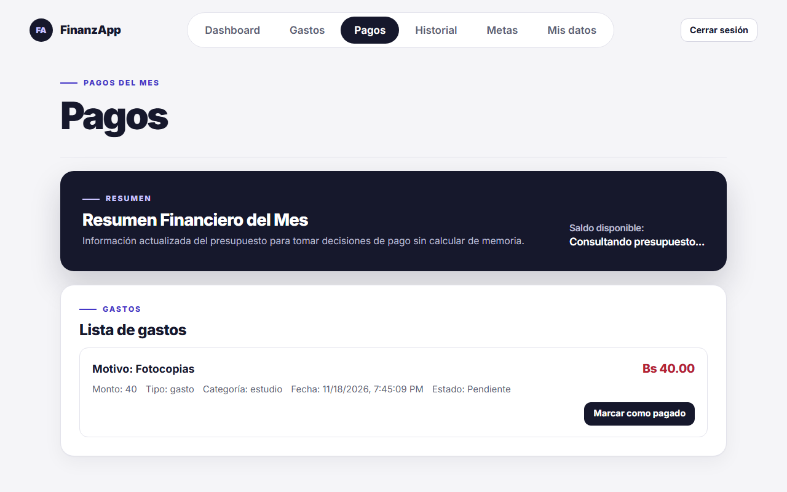

# Informe de accesibilidad: Lighthouse, axe y contraste AA

Fecha: 18/11/2026 · Herramientas: **Lighthouse 12.8** (categoría Accesibilidad, escritorio) y **axe-core 4** (reglas WCAG 2.1 A y AA) desde Playwright.

## Cómo reproducirlo

Con PostgreSQL encendido y desde la raíz del repo:

```bash
pnpm install
pnpm run install:e2e:browser          # una sola vez: descarga Chromium para Playwright
pnpm run a11y:lighthouse              # reporte Lighthouse de las 11 pantallas -> docs/accesibilidad/lighthouse/
pnpm run test:e2e -- e2e/accesibilidad.spec.ts   # axe WCAG 2.1 AA + contraste de tokens
```

El script [`e2e/lighthouse.mjs`](../../e2e/lighthouse.mjs) levanta el backend y el frontend si no están encendidos y audita las pantallas privadas con la cuenta E2E (con sesión y con datos), no la pantalla de login a la que redirigen sin sesión.

## 1. Resultado de Lighthouse

| Pantalla | Ruta | Antes | Después | Reporte |
|---|---|---:|---:|---|
| Inicio | `/` | 100 | 100 | [antes](lighthouse/antes/inicio.html) · [después](lighthouse/inicio.html) |
| Iniciar sesión | `/login` | 100 | 100 | [antes](lighthouse/antes/login.html) · [después](lighthouse/login.html) |
| Registro | `/register` | 100 | 100 | [antes](lighthouse/antes/registro.html) · [después](lighthouse/registro.html) |
| Recuperar contraseña | `/forgot-password` | 100 | 100 | [antes](lighthouse/antes/recuperar-contrasena.html) · [después](lighthouse/recuperar-contrasena.html) |
| Dashboard | `/dashboard` | 100 | 100 | [antes](lighthouse/antes/dashboard.html) · [después](lighthouse/dashboard.html) |
| Gastos | `/gastos` | 100 | 100 | [antes](lighthouse/antes/gastos.html) · [después](lighthouse/gastos.html) |
| **Pagos** | `/pagos` | **98** | **100** | [antes](lighthouse/antes/pagos.html) · [después](lighthouse/pagos.html) |
| Historial | `/historial` | 100 | 100 | [antes](lighthouse/antes/historial.html) · [después](lighthouse/historial.html) |
| Metas | `/metas` | 100 | 100 | [antes](lighthouse/antes/metas.html) · [después](lighthouse/metas.html) |
| Mis datos | `/mis-datos` | 100 | 100 | [antes](lighthouse/antes/mis-datos.html) · [después](lighthouse/mis-datos.html) |
| Analítica | `/analitica` | 100 | 100 | [antes](lighthouse/antes/analitica.html) · [después](lighthouse/analitica.html) |

Resumen en datos: [`lighthouse/antes/resumen.json`](lighthouse/antes/resumen.json) y [`lighthouse/resumen.json`](lighthouse/resumen.json). Para ver un reporte, abre el `.html` en el navegador.

## 2. Interpretación y correcciones

Un 100 en Lighthouse **no significa que la app sea accesible**: Lighthouse solo revisa lo que se puede comprobar de forma automática (alrededor de un tercio de los criterios WCAG). Por eso, además de corregir lo que marcó, revisamos a mano lo que Lighthouse lista como «comprobaciones manuales» (foco visible, orden de foco, placeholder) y medimos el contraste de cada token.

| # | Hallazgo | Fuente | Criterio WCAG | Por qué importa | Corrección |
|---|---|---|---|---|---|
| 1 | **Encabezados fuera de orden en Pagos**: tras el `<h1>Pagos</h1>` venía un `<h3>` («Resumen Financiero del Mes»), saltándose el nivel 2. | Lighthouse `heading-order` (Pagos 98) | 1.3.1 Información y relaciones | Quien usa lector de pantalla navega por encabezados; un salto de nivel le hace creer que falta una sección. | El título pasa a `<h2>` con el mismo estilo ([`Pagos.tsx`](../../frontend/src/pages/Pagos.tsx)). Pagos sube a 100. |
| 2 | **Anillo de foco casi invisible sobre fondos claros**: el foco de botones y enlaces era un contorno lavanda `#C9C3FF`, que sobre blanco tiene **1.65:1**. | Revisión manual (Lighthouse lo deja como comprobación manual) | 2.4.7 Foco visible · 1.4.11 Contraste no textual (3:1) | Quien navega con teclado no sabe dónde está. | Anillo índigo `--accent-text` de 3 px (**8.08:1** sobre blanco) rodeado de un halo lavanda que lo separa en fondos oscuros (**10.6:1** sobre tinta) ([`index.css`](../../frontend/src/index.css)). |
| 3 | **Placeholder con contraste bajo**: `--placeholder #7A7D92` sobre blanco da **4.06:1**. En Login y Registro el placeholder repite la etiqueta del campo. | Medición de tokens | 1.4.3 Contraste mínimo (4.5:1) | Texto gris claro difícil de leer con baja visión o con el sol de frente en el celular. | `--placeholder` pasa a `#6B6E83` (**5.02:1**). Se actualizó también en [`tokens-y-componentes.md`](../tokens-y-componentes.md) y en la [guía de estilos](../guia-estilos-figma.html). |

Evidencia visual de las correcciones:

| Foco en el botón principal (fondo claro) | Foco en el enlace activo del menú (botón oscuro) |
|---|---|
|  |  |



## 3. axe-core en todas las pantallas y estados

[`e2e/accesibilidad.spec.ts`](../../e2e/accesibilidad.spec.ts) corre axe con las reglas `wcag2a`, `wcag2aa`, `wcag21a` y `wcag21aa` (contraste incluido) y espera **cero violaciones** en:

- Las 5 pantallas públicas sin sesión (inicio, login, registro, recuperar contraseña, analítica).
- El **estado de error** del login (credenciales incorrectas, mensaje con `role="alert"`).
- Las 6 pantallas privadas **con datos cargados** (ingreso, gastos, presupuesto y una meta).
- El **diálogo** «¿Eliminar tu cuenta?» abierto.

Resultado: **16 de 16 pruebas pasan** (incluidas las de contraste y foco de la sección 4).

## 4. Contraste AA comprobado

Los pares texto/fondo que usa la interfaz, calculados con la fórmula de luminancia relativa de WCAG. La misma tabla se verifica en cada corrida de la suite E2E (prueba «los pares de tokens de texto cumplen contraste AA»), así que si alguien cambia un color y rompe el contraste, la prueba falla.

**Texto (mínimo 4.5:1)**

| Texto | Fondo | Contraste | Resultado |
|---|---|---:|---|
| `--ink` #16182C | `--surface` #FFFFFF | 17.48:1 | Cumple AA |
| `--ink` #16182C | `--bg` #F5F5F8 | 16.07:1 | Cumple AA |
| `--ink` #16182C | `--surface-2` #F0F0F6 | 15.40:1 | Cumple AA |
| `--ink` #16182C | `--highlight` #C9C3FF | 10.60:1 | Cumple AA |
| `--ink` #16182C | `--accent-soft` #ECEBFA | 14.84:1 | Cumple AA |
| `--muted` #5C5F75 | `--surface` #FFFFFF | 6.27:1 | Cumple AA |
| `--muted` #5C5F75 | `--bg` #F5F5F8 | 5.76:1 | Cumple AA |
| `--muted` #5C5F75 | `--surface-2` #F0F0F6 | 5.52:1 | Cumple AA |
| `--accent-text` #4436C7 | `--surface` #FFFFFF | 8.08:1 | Cumple AA |
| `--accent-text` #4436C7 | `--bg` #F5F5F8 | 7.43:1 | Cumple AA |
| `--accent-text` #4436C7 | `--accent-soft` #ECEBFA | 6.86:1 | Cumple AA |
| `--accent-ink` #FFFFFF | `--accent` #16182C | 17.48:1 | Cumple AA |
| `--accent-ink` #FFFFFF | `--accent-hover` #2A2D4A | 13.35:1 | Cumple AA |
| `--green` #17734F | `--surface` #FFFFFF | 5.83:1 | Cumple AA |
| `--green` #17734F | `--green-soft` #E3F4EC | 5.11:1 | Cumple AA |
| `--amber` #8A5300 | `--surface` #FFFFFF | 6.33:1 | Cumple AA |
| `--amber` #8A5300 | `--amber-soft` #FDF0D9 | 5.62:1 | Cumple AA |
| `--red` #B42335 | `--surface` #FFFFFF | 6.50:1 | Cumple AA |
| `--red` #B42335 | `--red-soft` #FDE8EB | 5.54:1 | Cumple AA |
| `--label-destacado` #2C2A55 | `--highlight` #C9C3FF | 8.11:1 | Cumple AA |
| `--surface` #FFFFFF | `--ink` #16182C | 17.48:1 | Cumple AA |
| `--on-dark-muted` #B9BBD0 | `--ink` #16182C | 9.23:1 | Cumple AA |
| `--highlight` #C9C3FF | `--ink` #16182C | 10.60:1 | Cumple AA |
| `--red-on-dark` #FFB3BD | `--ink` #16182C | 10.35:1 | Cumple AA |
| `--placeholder` **#6B6E83** (antes #7A7D92: 4.06:1) | `--surface` #FFFFFF | **5.02:1** | Cumple AA (corregido) |

**Indicadores que no son texto (mínimo 3:1)**

| Indicador | Fondo | Contraste | Resultado |
|---|---|---:|---|
| Anillo de foco `--accent-text` #4436C7 | `--surface` #FFFFFF | 8.08:1 | Cumple (antes lavanda: 1.65:1) |
| Anillo de foco `--accent-text` #4436C7 | `--bg` #F5F5F8 | 7.43:1 | Cumple |
| Halo de foco `--highlight` #C9C3FF | `--ink` #16182C | 10.60:1 | Cumple |
| Borde de campo enfocado `--accent-text` #4436C7 | `--surface` #FFFFFF | 8.08:1 | Cumple |

Regla que se mantiene: **no usar texto blanco sobre lavanda** (`--surface` sobre `--highlight` da 1.65:1); sobre lavanda el texto va en tinta.

## 5. Lo que queda fuera de lo automático

- Verificado con teclado en las pruebas: en Login, Tab va Correo → Contraseña → «Mantener sesión iniciada» → «Iniciar sesión» (captura de arriba), y el diálogo de eliminar cuenta abre con el foco en «Conservar mi cuenta» (`e2e/mis-datos.spec.ts`). El resto de pantallas no se recorrió tecla por tecla.
- No se probó con un lector de pantalla real (NVDA/VoiceOver); queda como siguiente paso.
- En Figma, la variable `placeholder` de la colección «Tokens» debe pasar a `#6B6E83` para que coincida con el código.
