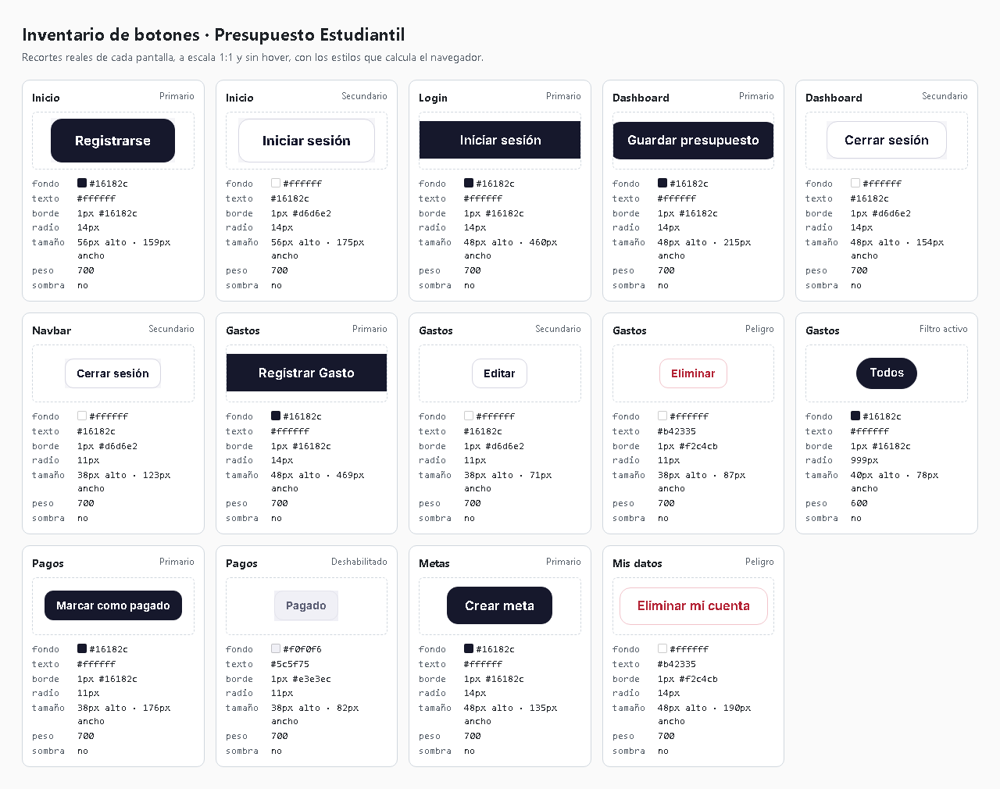

# Clase 23 · Inventario y tokens

**Integrantes:** Franco Enrique · Ariany Claure — **Modalidad:** con IA

---

## 1. Inventario de botones



La captura sale de la app corriendo. Recortamos cada botón a escala 1:1, sin hover, y anotamos los estilos que calcula el navegador. Los agrupamos por tipo: primario, secundario, peligro, filtro y deshabilitado. Para volver a generarla:

```bash
node e2e/run-playwright.mjs test e2e/capturas-clase-23.spec.ts
```

Script: [e2e/capturas-clase-23.spec.ts](../e2e/capturas-clase-23.spec.ts) · datos crudos: [clase-23/inventario-botones.json](clase-23/inventario-botones.json)

| Tipo | Pantalla · botón | Fondo / texto | Radio | Alto × ancho |
|---|---|---|---|---|
| Primario | Inicio · Registrarse | `#16182c` / blanco | 14px | 56 × 159 |
| Primario | Login · Iniciar sesión | `#16182c` / blanco | 14px | 48 × **460** (todo el ancho) |
| Primario | Dashboard · Guardar presupuesto | `#16182c` / blanco | 14px | 48 × 215 |
| Primario | Gastos · Registrar Gasto | `#16182c` / blanco | 14px | 48 × **469** (todo el ancho) |
| Primario | Pagos · Marcar como pagado | `#16182c` / blanco | **11px** | **38** × 176 |
| Primario | Metas · Crear meta | `#16182c` / blanco | 14px | 48 × 135 |
| Secundario | Inicio · Iniciar sesión | blanco / `#16182c` | 14px | 56 × 175 |
| Secundario | Dashboard · Cerrar sesión | blanco / `#16182c` | 14px | 48 × 154 |
| Secundario | Navbar · Cerrar sesión | blanco / `#16182c` | **11px** | **38** × 123 |
| Secundario | Gastos · Editar | blanco / `#16182c` | 11px | 38 × 71 |
| Peligro | Gastos · Eliminar | blanco / `#b42335` | 11px | 38 × 87 |
| Peligro | Mis datos · Eliminar mi cuenta | blanco / `#b42335` | 14px | 48 × 190 |
| Filtro | Gastos · Todos (activo) | `#16182c` / blanco | **999px** | 40 × 78, peso 600 |
| Deshabilitado | Pagos · Pagado | `#f0f0f6` / `#5c5f75` | 11px | 38 × 82 |

Después del rediseño los colores de los botones ya son coherentes: todos salen de `index.css`. Las diferencias que quedan están en el **radio**, el **tamaño** y los **estados**.

### Diferencias que encontramos

1. **Radio y tamaño de la acción principal.** La acción principal de casi todas las pantallas mide 48px de alto con radio 14px. En **Pagos**, en cambio, "Marcar como pagado" usa `btn-small` y mide 38px con radio 11px, aunque es justamente la acción principal de esa pantalla. En Inicio mide 56px (`btn-lg`). Así quedan tres altos (56 / 48 / 38) y tres radios (14 / 11 / 999px) para botones que comunican lo mismo.
2. **La misma acción con dos botones distintos en la misma pantalla.** En Dashboard aparecen dos "Cerrar sesión": el del Navbar (`btn-secondary btn-small`, 38px, radio 11px) y el del encabezado (`dashboard-logout`, 48px, radio 14px). Es una acción duplicada y además con formas diferentes.
3. **Ancho.** En Login y en Gastos el primario ocupa todo el ancho del formulario (460 y 469px). En Dashboard y en Metas el botón se ajusta al texto. Las cuatro pantallas tienen un formulario y no siguen la misma regla.
4. **Estados que faltan.**
   - **Cargando:** solo "Eliminar definitivamente" (Mis datos) cambia a "Eliminando…". "Iniciar sesión", "Guardar presupuesto", "Registrar Gasto" y "Marcar como pagado" no muestran que están trabajando, y se pueden pulsar dos veces.
   - **Hover:** el hover del primario está escrito a mano (`#2a2d4a`) y no tiene nombre.
   - **Tema oscuro:** no existe. `index.css` declara `color-scheme: light` y no hay ningún `prefers-color-scheme` ni `data-tema`.
5. **Peso del texto.** Los botones usan peso 700 y el filtro en píldora usa 600.

---

## 2. Tokens

Son cinco tokens nombrados por **uso**, no por apariencia. Los nombres se repiten igual en Figma (Variables, modos Claro y Oscuro) y en el código (`--color-accion`, …). Hoy no tocamos el código: la última columna muestra qué reemplazaría cada token.

| Token | Claro | Oscuro | Dónde se usa | Hoy en el código |
|---|---|---|---|---|
| `color-accion` | `#16182c` | `#c9c3ff` | Fondo del botón primario en todas las pantallas (Registrarse, Iniciar sesión, Guardar presupuesto, Registrar Gasto, Marcar como pagado, Crear meta), filtro activo `.seg.on`, enlace activo del Navbar | `--accent`, `--ink`, `#2a2d4a` (hover) |
| `color-texto` | `#16182c` | `#ffffff` | Títulos, cuerpo de texto, texto de botones secundarios y de filtros | `--ink`, `--text-h` (mismo valor, dos nombres), `#fff` suelto en Pagos |
| `color-texto-suave` | `#5c5f75` | `#b9bbd0` | Subtítulos, `row-meta`, etiquetas de filtro, `small`, texto del botón deshabilitado | `--text`, `--muted` (mismo valor, dos nombres), `#b9bbd0` a mano en Pagos y `.auth-side` |
| `color-error` | `#b42335` | `#ffb3bd` | Botones "Eliminar" y "Eliminar mi cuenta", montos de gasto, saldo negativo, `msg-err`, `chip.red` | `--red` (nombre por apariencia), `#ffb3bd` a mano en Pagos, `#f2c4cb` (borde de `btn-danger`) |
| `radio-control` | `14px` | `14px` | Botones, inputs, selects, filas de listas y mensajes | `--radius-sm`, más `11px` fijo en `btn-small` y `999px` en filtros |

**De dónde salen los valores oscuros:** la app no tiene tema oscuro, pero ya tiene "islas oscuras": `.dark-card` en Pagos y `.auth-side` en Login. Ahí alguien eligió a mano los colores sobre fondo `#16182c`: blanco para el texto, `#b9bbd0` para el texto suave, `#ffb3bd` para el saldo negativo y lavanda `#c9c3ff` para el acento. Tomamos esos mismos valores como modo Oscuro de cada token. Así el tema oscuro reutiliza decisiones que ya están probadas en la app.

**Lo que vimos al nombrar:**

- `--red`, `--green`, `--amber` y `--highlight` (lavanda) están nombrados **por apariencia**. Si mañana el error deja de ser rojo, el nombre `--red` queda mintiendo. Por eso lo llamamos `color-error`.
- Hay **tres nombres para un solo valor**: `--ink`, `--text-h` y `--accent` valen `#16182c`. También hay dos nombres para el gris: `--text` y `--muted`. Con tokens por uso, cada valor tiene un nombre por rol.
- Los siguientes candidatos serían `color-exito` (`--green`), `color-fondo` (`--bg`) y `espacio-4`. Hoy el espaciado está escrito a mano (gaps de 8, 10, 12, 14, 16 y 22px).

---

## 3. Colores fijos

**Pantalla revisada:** Pagos, archivo [frontend/src/pages/Pagos.tsx](../frontend/src/pages/Pagos.tsx).

**Qué buscamos** (Ctrl+Shift+F en VS Code, con regex activado y el archivo como filtro):

| Búsqueda | Patrón | Encontrados |
|---|---|---|
| Hex escritos a mano | `#[0-9a-fA-F]{3,8}\b` | **4** (3 valores distintos) |
| `rgb()` / `rgba()` | `rgba?\(` | **0** |
| Colores por nombre | `'(white\|black\|red\|green\|blue)'` | **0** |
| **Total de colores fijos** | | **4** |
| Variables bien usadas | `var\(--` | 7 |

Los cuatro están en la tarjeta oscura "Resumen Financiero del Mes":

| Línea | Valor | Para qué | Token que lo reemplazaría |
|---|---|---|---|
| 154 | `#fff` | título "Resumen Financiero del Mes" | `color-texto` (oscuro) |
| 157 | `#b9bbd0` | texto de ayuda | `color-texto-suave` (oscuro) |
| 162 | `#b9bbd0` | etiqueta "Saldo disponible" | `color-texto-suave` (oscuro) |
| 165 | `#ffb3bd` | saldo negativo | `color-error` (oscuro) |

**Hallazgo:** el resto de la pantalla ya lee variables (`var(--green)`, `var(--red)`, `var(--surface-2)`). Los colores fijos aparecen justo donde la pantalla se pone **oscura**: como no existen tokens para el modo oscuro, se escribieron a mano. Con los tokens de la sección 2, esos 4 valores pasan a ser el modo Oscuro de `color-texto`, `color-texto-suave` y `color-error`.

**Contexto de todo el frontend:** en `frontend/src` (`.tsx` y `.css`) hay **48** hex y **3** `rgba()`. De esos, 23 hex y 2 rgba están dentro de `:root` en `index.css`, que es donde corresponde porque ahí se definen las variables. Fuera de `:root` quedan sueltos 18 hex y 1 rgba en `index.css` (por ejemplo `#fff` ×8, `#2a2d4a` ×3 y `#d6d6e2` ×2), 3 hex en `Dashboard.css` y los 4 de Pagos.

Hoy solo contamos; no corregimos nada.
