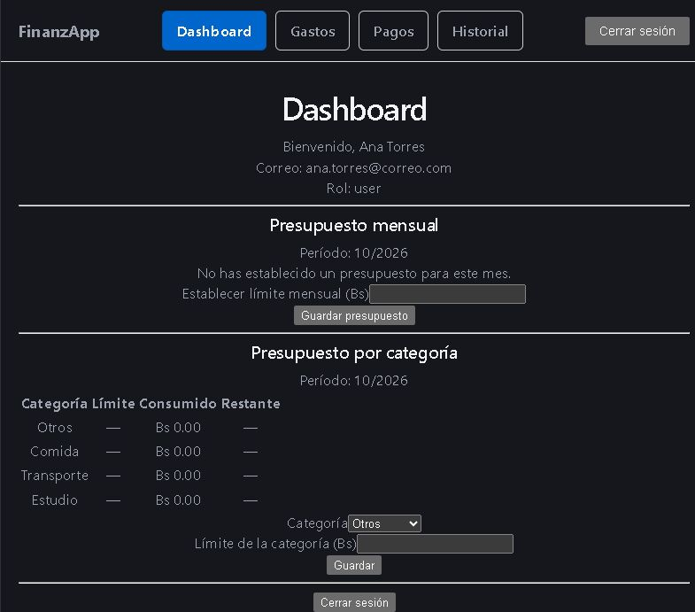
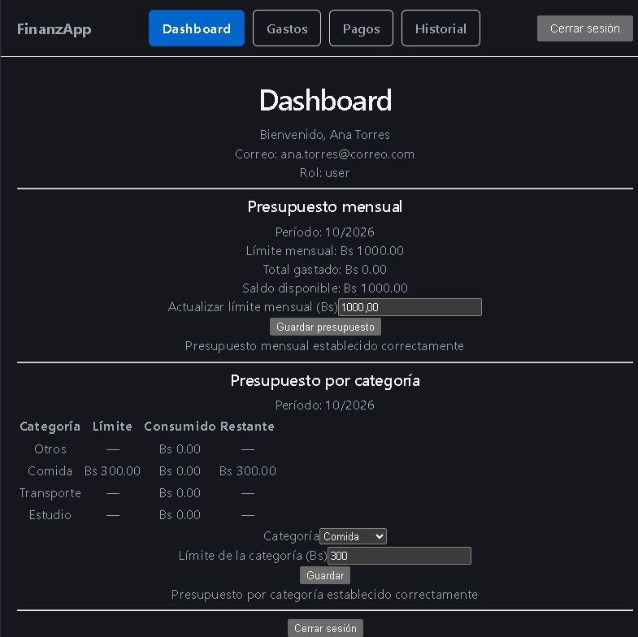
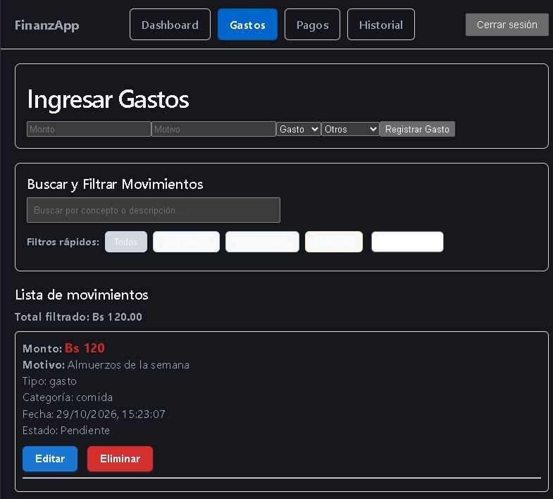
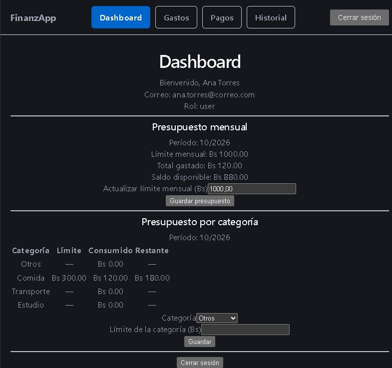

# Tarea 5 · Presupuesto por categoría

Presupuesto mensual **por categoría** sobre el proyecto recibido, con persistencia y aislamiento por usuario.

## Qué se agregó

| Backend | Frontend |
|---|---|
| Modelo `PresupuestoCategoria` (índice único `userId + categoria + mes + anio`) | Sección **"Presupuesto por categoría"** en `Dashboard.tsx`: tabla + formulario |
| `presupuestoCategoriaController.js` (guardar y consultar) | Tabla con **Categoría · Límite · Consumido · Restante** |
| `presupuestoCategoriaRoutes.js` montado en `/api/presupuesto-categoria` | Formulario: `<select>` de categoría + monto + **Guardar** |
| 6 pruebas con Jest | Mensajes `role="status"` / `role="alert"` |

Categorías fijas (las mismas del `<select>` de Gastos): **otros, comida, transporte, estudio**.

### Endpoints

| Método | Ruta | Descripción |
|---|---|---|
| `POST` | `/api/presupuesto-categoria/establecer` | Crea o actualiza (upsert) el límite de una categoría |
| `GET` | `/api/presupuesto-categoria/obtener?mes=M&anio=A` | Devuelve siempre las 4 categorías con `limite`, `consumido` y `restante` |

Las dos exigen `Authorization: Bearer <token>`.

### Reglas aplicadas

1. El límite debe ser un número finito mayor a 0.
2. La categoría es obligatoria y se normaliza a minúsculas (`.trim()`).
3. La categoría debe ser una de las 4 fijas; si no, `400`.
4. `mes` entero 1–12 y `anio` entero ≥ 2000.
5. El límite no puede ser menor que lo ya consumido en esa categoría ese mes.
6. Upsert por `(userId, categoria, mes, anio)`.
7. Consumido = suma de `Gasto.monto` del usuario, esa categoría, en `[inicioMes, inicioMesSiguiente)`.

El cambio es **aditivo**: no se modificó `registrarGasto` ni el presupuesto mensual.

## Pruebas

```bash
cd backend
npm test
```

```
Test Suites: 4 passed, 4 total
Tests:       26 passed, 26 total
```

Las 6 nuevas están en `backend/tests/presupuestoCategoriaController.test.js`.

## Recorrido de evidencia

Usuario **Ana Torres** (`ana.torres@correo.com`).

### 1. Dashboard sin presupuesto

Las 4 categorías aparecen con `—` en Límite/Restante y `Bs 0.00` consumido.



### 2. Crear presupuesto por categoría

Se elige **Comida** y se guarda un límite de **Bs 300**. El mensaje de éxito confirma la creación y la fila queda `Límite Bs 300.00 · Consumido Bs 0.00 · Restante Bs 300.00`.



### 3. Registrar un gasto de esa categoría

En **Gastos** se registra: monto `120`, motivo `Almuerzos de la semana`, categoría `comida`.



### 4. El consumido se actualiza

De vuelta en el Dashboard: **Consumido Bs 120.00** y **Restante Bs 180.00**.


### 5. Persistencia tras recargar (F5)

Después de recargar la página los valores siguen igual: `Bs 300.00 · Bs 120.00 · Bs 180.00`. No se pierde nada porque se leen de la base, no del estado del formulario.



### 6. Verificación con otro usuario

Se cierra sesión y se registra **Luis Rojas** (`luis.rojas@correo.com`). Su Dashboard muestra las 4 categorías **sin límite** (`—`) y **Bs 0.00** consumido: no ve nada del usuario anterior.


## Verificación en la base de datos

Consulta directa a PostgreSQL con Sequelize después del recorrido:

```json
{
  "usuarios": [
    { "id": 2, "name": "Ana Torres", "email": "ana.torres@correo.com" },
    { "id": 3, "name": "Luis Rojas", "email": "luis.rojas@correo.com" }
  ],
  "presupuestosCategoria": [
    {
      "id": 1,
      "userId": 2,
      "categoria": "comida",
      "mes": 10,
      "anio": 2026,
      "limite": "300.00"
    }
  ],
  "gastos": [
    { "id": 1, "monto": "120", "categoria": "comida", "tipo": "gasto", "userId": 2 }
  ]
}
```

El presupuesto y el gasto pertenecen a `userId = 2` (Ana). El usuario `3` (Luis) **no tiene registros**, y el `GET` filtra siempre por `req.user.id`, por eso su pantalla sale vacía.

## Cómo levantarlo

```bash
# Base: crear presupuesto_estudiantil_ihc en PostgreSQL
# backend/.env con DB_NAME, DB_USER, DB_PASSWORD, DB_HOST, DB_PORT, JWT_SECRET

cd backend && npm install && npm run dev     # http://localhost:4000
cd frontend && npm install && npm run dev    # http://localhost:5173
```

La tabla `PresupuestoCategoria` la crea `sequelize.sync({ alter: true })` al arrancar el backend.
